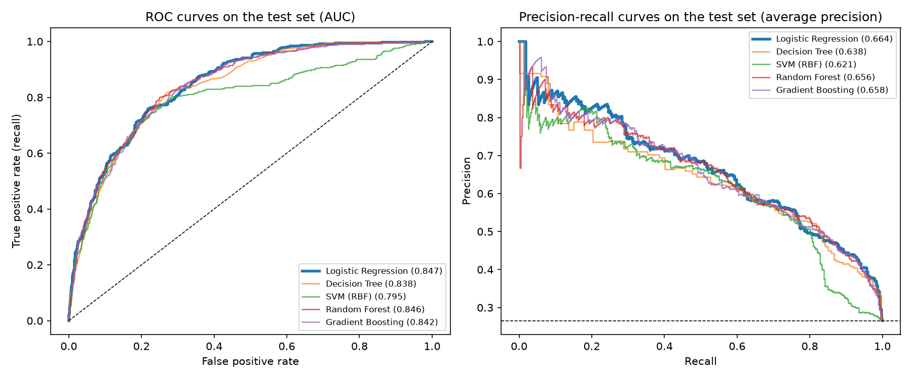
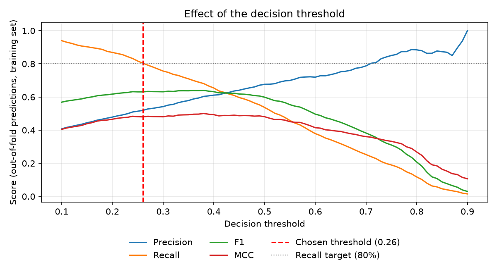
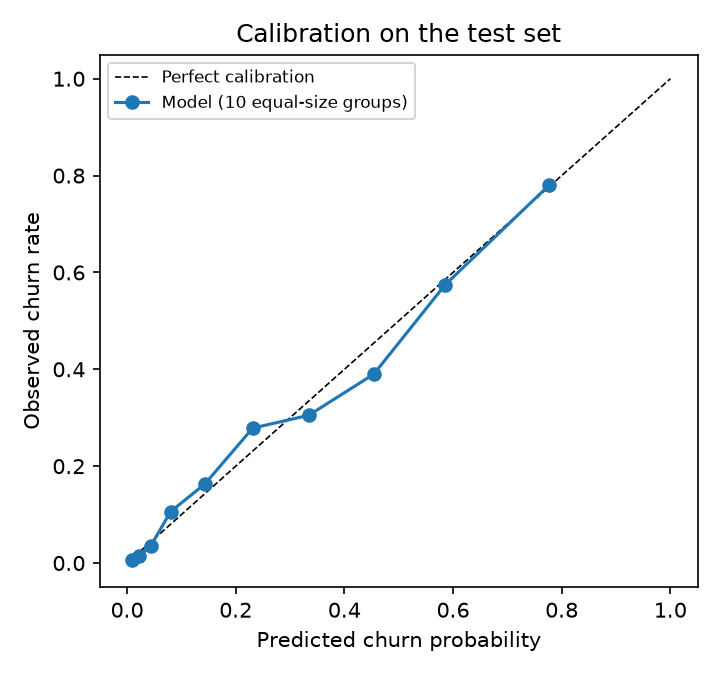
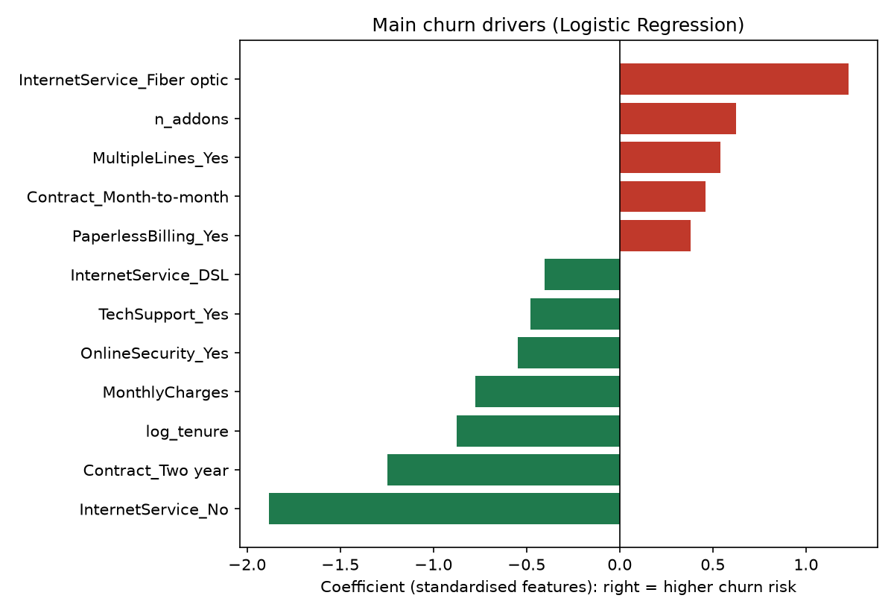

# Telco Customer Churn Prediction

Predicts which telecom customers are likely to cancel their subscription, and serves the
model in a small Streamlit app that scores one customer or a whole CSV file.

The dataset is IBM's public *Telco Customer Churn* sample: 7,043 customers, 19 attributes,
26.5% churners.

| Result on the held-out test set (1,409 customers) | |
|---|---|
| Selected model | Logistic regression (2 KB once saved) |
| ROC-AUC | 0.847 (95% CI 0.825 to 0.868) |
| PR-AUC | 0.664 (baseline 0.265) |
| At the chosen threshold (0.26) | 79% of churners caught, 50% of alerts are real churners |
| Brier score | 0.135 (0.195 when always predicting the base rate) |

## Method

1. **Split.** Stratified 80/20 split. The test set is used once, at the very end.
2. **One pipeline.** Feature engineering, scaling, one-hot encoding and the classifier are a
   single scikit-learn `Pipeline`. It is re-fitted inside every cross-validation fold, and the
   same object is loaded by the app, so training and inference cannot drift apart.
3. **Model comparison.** Five model families are tuned with 5-fold cross-validation on the
   training set and compared on PR-AUC, which suits an imbalanced target.
4. **Model selection.** One-standard-error rule: among the models statistically tied with
   the best one, keep the simplest.
5. **Decision threshold.** Chosen on out-of-fold predictions of the training set: the highest
   threshold that still catches 80% of churners. Missing a churner costs more than sending
   a retention offer to a loyal customer.
6. **Final evaluation.** The selected pipeline is evaluated once on the test set, with
   bootstrap confidence intervals and a calibration check.

## Results

Cross-validation on the training set (mean ± standard deviation over 5 folds):

| Model | PR-AUC | ROC-AUC | Precision at 80% recall |
|---|---|---|---|
| **Logistic Regression (selected)** | 0.673 ± 0.017 | 0.850 ± 0.011 | 0.519 |
| Gradient Boosting | 0.665 ± 0.023 | 0.848 ± 0.011 | 0.521 |
| Random Forest | 0.664 ± 0.022 | 0.846 ± 0.011 | 0.517 |
| SVM (RBF) | 0.645 ± 0.019 | 0.803 ± 0.017 | 0.447 |
| Decision Tree | 0.630 ± 0.031 | 0.829 ± 0.013 | 0.500 |

Logistic regression, random forest and gradient boosting are tied within the noise of the
folds, so the simplest and most interpretable one is kept. Its cross-validated PR-AUC (0.673)
and its test PR-AUC (0.664) agree, which is the sign that the evaluation is not leaking.

Test set, selected model:

| Threshold | Precision | Recall | F1 | MCC |
|---|---|---|---|---|
| 0.26 (chosen: 80% recall target) | 0.502 | 0.786 | 0.613 | 0.452 |
| 0.38 (alternative: maximum MCC) | 0.574 | 0.674 | 0.620 | 0.470 |



| Threshold trade-off | Calibration |
|---|---|
|  |  |

### What drives churn



Month-to-month contracts, fibre-optic internet and short tenure push the risk up; two-year
contracts, long tenure, online security and tech support pull it down. Coefficients are
conditional on the other features (monthly charges and the services a customer buys are
strongly correlated), so they describe the model, not causal effects.

### About class imbalance

No resampling and no class weights are used. For this dataset they do not improve how well
customers are ranked, and they distort the predicted probabilities. The imbalance is handled
at the decision threshold instead, and the model stays well calibrated: a customer scored
at 30% belongs to a group in which about 30% actually churn.
`experiments/smote_vs_class_weight.py` reproduces the comparison with SMOTE and class
weights (it needs `imbalanced-learn`).

## What changed since the first version

The project started as a Colab notebook (`notebooks/01_first_version_colab.ipynb`). Reviewing
it showed several problems, which this version fixes:

| First version | This version |
|---|---|
| SMOTE applied before cross-validation. The tuned random forest scored F1 = 0.85 in cross-validation and 0.60 on the test set, because validation folds contained synthetic copies of training rows. | All preprocessing is inside the pipeline. Cross-validation and test scores agree. |
| Best model and decision threshold both picked on the test set. | Both picked on the training set (cross-validation and out-of-fold predictions). |
| The saved model was a 500-tree random forest of 115 MB (test ROC-AUC 0.828), although the comparison table favoured another model. | A 2 KB logistic regression with test ROC-AUC 0.847. |
| The app rebuilt the 30 one-hot columns by hand and accepted impossible customers (add-ons without internet). | The app sends raw fields to the same pipeline; impossible combinations are disabled. |
| Blank `TotalCharges` replaced by the median. | Replaced by 0: these 11 customers have a tenure of 0 months. |
| App served from Colab through a temporary tunnel. | Runs locally with one command, or on Streamlit Community Cloud. |

## Run it

```bash
python -m venv .venv
source .venv/bin/activate        # Windows: .venv\Scripts\activate
pip install -r requirements.txt

python -m churn.train            # about 2 minutes: tunes, selects, evaluates, saves the model
python -m pytest -q              # tests
streamlit run app.py             # web app on http://localhost:8501
```

`python -m churn.train` rewrites `models/`, `reports/metrics.json`, `reports/results.md` and
the figures. Numbers can move slightly with other library versions.

To put the app online for free: push the repository to GitHub, then create an app on
[Streamlit Community Cloud](https://streamlit.io/cloud) pointing at `app.py`.

## Project structure

```
churn/
  data.py        loading, cleaning, train/test split
  features.py    feature engineering and preprocessing pipeline
  train.py       tuning, model selection, threshold, final evaluation
  evaluate.py    metrics and figures
  predict.py     inference helpers used by the app and the tests
app.py           Streamlit app (single customer and CSV batch scoring)
tests/           pytest suite
experiments/     optional SMOTE vs class-weight comparison
models/          saved pipeline and its metadata
reports/         metrics, results table and figures
notebooks/       first version of the project, kept for history
data/            the dataset
```

## Limits and next steps

- The data is a single snapshot. There is no time dimension, so the model cannot be tested
  on later customers, which is what matters in production.
- All strong models stop around ROC-AUC 0.85: the ceiling comes from the available
  attributes, not from the algorithm. Usage or support-ticket data would help more than a
  bigger model.
- The 80% recall target is a placeholder for a real cost analysis (value of a retained
  customer against the cost of a retention offer).

## Authors

Academic project (Master SDSI, Faculté Pluridisciplinaire de Nador) by
**Widad Aoulad Haddou** and **Khaoula Bouhsiss**.
